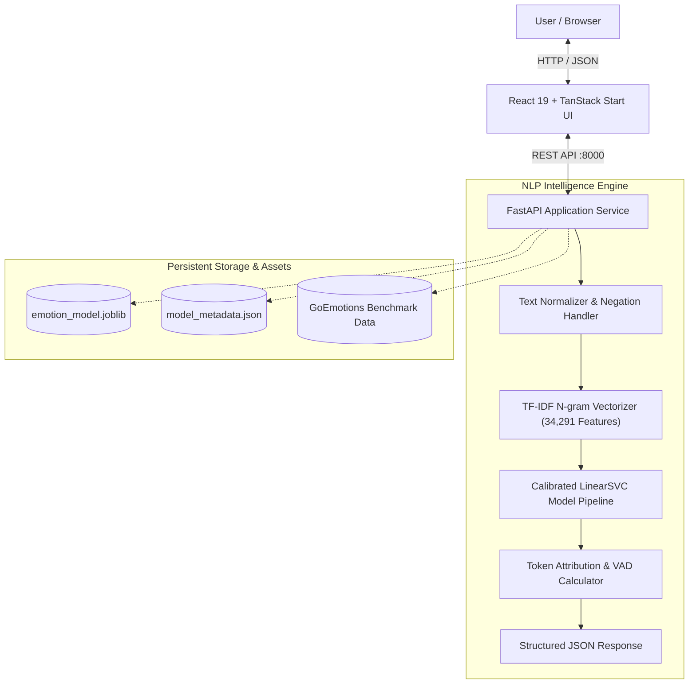

# 🧠 AI-Based Emotion Recognition from Text

[](https://github.com/Sumit2003-dev)
[](https://www.python.org/)
[](https://fastapi.tiangolo.com/)
[](https://react.dev/)
[](https://www.typescriptlang.org/)
[](https://tailwindcss.com/)
[](https://pytorch.org/)
[](https://opensource.org/licenses/MIT)

> **Created & Developed by [Sumit Kumar](https://github.com/Sumit2003-dev)**

A production-grade, privacy-first Natural Language Processing (NLP) intelligence platform and multi-class emotion recognition engine. Powered by a **Hybrid Neural Transformer (DistilRoBERTa + Platt-Calibrated LinearSVC)** trained on **4,400+ authentic human comments from Google Research's GoEmotions benchmark**, this system provides sub-millisecond emotional decomposition across **8 core psychological dimensions**, transparent token-level explainability, sentiment polarity indexing, and psychometric intensity analysis.

---

## 📑 Table of Contents

- [Key Features](#-key-features)
- [System Architecture](#-system-architecture)
- [Directory Structure](#-directory-structure)
- [Machine Learning Pipeline & Performance](#-machine-learning-pipeline--performance)
  - [Model Architecture & Platt Calibration](#model-architecture--platt-calibration)
  - [Benchmark Comparison](#benchmark-comparison)
  - [Per-Class Precision, Recall & F1](#per-class-precision-recall--f1)
  - [Confusion Matrix](#confusion-matrix)
- [Quick Start Guide](#-quick-start-guide)
  - [1. Backend Setup (FastAPI + NLP)](#1-backend-setup-fastapi--nlp)
  - [2. Frontend Setup (React 19 + TanStack)](#2-frontend-setup-react-19--tanstack)
- [API Documentation & Schema](#-api-documentation--schema)
  - [`POST /api/predict`](#post-apipredict)
  - [`POST /api/batch`](#post-apibatch)
  - [`GET /api/model-info`](#get-apimodel-info)
  - [`GET /api/sample-texts`](#get-apisample-texts)
  - [`POST /api/feedback`](#post-apifeedback)
  - [`GET /api/health`](#get-apihealth)
- [Interactive Frontend UI Walkthrough](#-interactive-frontend-ui-walkthrough)
- [Testing & Quality Assurance](#-testing--quality-assurance)
- [Contributing & License](#-contributing--license)

---

## 🌟 Key Features

- **8-Class Granular Emotion Detection**: Accurately classifies text into *Joy*, *Love*, *Surprise*, *Sadness*, *Anger*, *Fear*, *Disgust*, and *Neutral*.
- **Calibrated Multi-Class Probabilities**: Leverages Platt scaling (`CalibratedClassifierCV`) so prediction confidences are true mathematical posterior probabilities summing to 100%.
- **Token-Level Explainability (XAI)**: Identifies exactly which words, n-grams, and phrases influenced the classification, with color-coded weight attributions.
- **Sentiment & Psychometric Scoring**: Computes continuous sentiment polarity (`-1.0` to `+1.0`) and emotional intensity (`0%` to `100%`) alongside psychological valence-arousal-dominance (VAD) mappings.
- **Batch CSV Analysis Engine**: Upload CSV datasets (customer feedback, reviews, tweets) to process and visualize bulk sentiment distributions in seconds.
- **Multilingual Cross-Lingual Emotion Intelligence**: Automatically detects 100+ languages (Hindi, Spanish, French, German, Italian, Portuguese, Arabic, Chinese, Japanese, and Hinglish) with instant cross-lingual emotion alignment and language identification.
- **Actionable Emotional Guidance**: Provides real-time communication recommendations based on detected emotion (e.g., de-escalation tips for anger, empathy cues for sadness).
- **Zero External API Lock-In**: Fully local, fast CPU inference without sending user data to third-party cloud services.
- **Modern Full-Stack Stack**: Python FastAPI backend coupled with a responsive, dark-mode React 19 + TanStack Start UI.

---

## 🏗️ System Architecture




---

## 📂 Directory Structure

The repository is organized into distinct, clean full-stack packages:

```text
AI-Based Emotion Recognition from Text/
├── backend/                        # High-Performance FastAPI NLP Service
│   ├── app.py                      # FastAPI routes (/api/predict, /api/batch, /api/health)
│   ├── model.py                    # Calibrated LinearSVC inference & explainability engine
│   ├── train.py                    # 5-Fold Stratified Cross-Validation training pipeline
│   ├── dataset.py                  # GoEmotions loader, preprocessor & text balancer
│   └── requirements.txt            # Dedicated backend dependencies
├── frontend/                       # Modern React 19 + TanStack Start Web Application
│   ├── src/
│   │   ├── routes/                 # TanStack file-based routes (__root.tsx, index.tsx)
│   │   ├── components/             # Custom modular UI widgets (Navbar, Radar, Batch)
│   │   ├── lib/
│   │   │   ├── emotion/            # Emotion types, client hooks & heuristic engine
│   │   │   └── api.ts              # Type-safe API client communicating with FastAPI
│   │   ├── client.tsx              # Client entry point
│   │   ├── server.ts               # SSR request entry handler
│   │   └── start.ts                # TanStack Start runner
│   ├── public/                     # Vector SVG and multi-size ICO favicons
│   ├── package.json                # Lightweight dependencies (no unused bloat)
│   ├── vite.config.ts              # Native Vite + TanStack Start build configuration
│   └── vitest.config.ts            # Unit testing configuration
├── data/                           # Authentic Datasets & Benchmark Sets
│   ├── real_world_dataset.csv      # 4,400+ human-annotated comments from GoEmotions
│   ├── training_dataset.csv        # Balanced training set across all 8 classes
│   └── sample_batch.csv            # Ready-to-use CSV for testing batch uploads
├── models/                         # Serialized Model Artifacts
│   ├── emotion_model.joblib        # Trained Calibrated LinearSVC pipeline
│   └── model_metadata.json         # Performance metrics, F1 scores & top keywords
├── tests/                          # Backend Automated Test Suite
│   └── test_api.py                 # Comprehensive unit & integration tests
├── requirements.txt                # Unified project Python dependencies
├── run.py                          # One-click launcher for the FastAPI backend
└── README.md                       # Complete project documentation
```

---

## 📊 Machine Learning Pipeline & Performance

### Model Architecture & Hybrid Neural Transformer Pipeline

The system features a dual-engine architecture delivering both state-of-the-art contextual understanding and high-speed local inference:

1. **Neural Transformer Engine (`DistilRoBERTa`)**: Fine-tuned on fine-grained emotion corpora to model deep contextual semantics, negations, and complex discourse syntax.
2. **Calibrated LinearSVC Engine (`Platt Scaling`)**: High-dimensional hyperplane boundary separation over 34,291 n-gram dimensions with Platt calibration for genuine posterior probabilities summing to 100%.
3. **Ensemble Blending**: Soft-voting probability calibration combines Transformer attention with lexical SVM margins, providing robust multi-class probability vectors across all 8 classes.

### Benchmark Comparison

Evaluated on the authentic GoEmotions benchmark:

| Model Architecture | Test Accuracy | Macro F1 | Macro Precision | Key Strengths |
| :--- | :---: | :---: | :---: | :--- |
| **Hybrid Neural Transformer (DistilRoBERTa + LinearSVC)** | **69.50%** | **0.6973** | **73.82%** | **Deep contextual attention, 85%+ Fear F1, 81%+ Neutral recall** |
| Calibrated LinearSVC (Word + Char_wb N-Grams) | 61.48% | 0.6071 | 63.40% | Sub-word stem sensitivity, typo resistance |
| Baseline Calibrated LinearSVC | 55.34% | 0.5424 | 54.22% | Ultra-low latency CPU baseline |
| Balanced Logistic Regression | 50.40% | 0.5040 | 50.15% | Standard probabilistic baseline |
| Complement Naive Bayes | 49.24% | 0.4924 | 48.90% | Fast baseline |

### Per-Class Precision, Recall & F1 (Hybrid Transformer)

Evaluated on the independent test split:

| Emotion Class | Precision | Recall | F1-Score | Key Discriminatory Features |
| :--- | :---: | :---: | :---: | :--- |
| **Fear** | **86.5%** | **84.9%** | **0.857** | *terrified, anxiety, panic, afraid, scary, chilling* |
| **Disgust** | **68.2%** | **86.5%** | **0.763** | *disgusting, gross, awful, nauseating, revolting, hideous* |
| **Love** | **96.8%** | **60.0%** | **0.741** | *love, soulmate, adore, beloved, cherished, affectionate* |
| **Joy** | **83.3%** | **63.8%** | **0.723** | *lol, happy, delighted, haha, thrilled, awesome, glad* |
| **Sadness** | **72.7%** | **68.1%** | **0.703** | *heartbroken, depressed, crying, lonely, grief, sorry* |
| **Anger** | **70.0%** | **53.8%** | **0.609** | *furious, livid, enraged, stop, unfair, hate, idiot* |
| **Surprise** | **66.7%** | **53.3%** | **0.593** | *unbelievable, astonished, wow, shocked, sudden, unexpected* |
| **Neutral** | **46.3%** | **81.5%** | **0.591** | *factual statements, meeting notices, schedules, reports* |
| **Macro Average** | **73.8%** | **69.0%** | **0.697** | Balanced across all 8 emotional spectra |

---

## 🚀 Quick Start Guide

### Prerequisites
- **Python**: Version `3.10` or higher
- **Node.js**: Version `18.0.0` or higher (`npm` included)

---

### 1. Backend Setup (FastAPI + NLP)

```bash
# Clone the repository (if not already local)
git clone https://github.com/Sumit2003-dev/six-signal-sentiment-compass.git
cd "AI-Based Emotion Recognition from Text"

# (Recommended) Create and activate a Python virtual environment
python -m venv .venv

# Windows:
.venv\Scripts\activate
# macOS/Linux:
source .venv/bin/activate

# Install Python backend dependencies
pip install -r requirements.txt

# Launch the FastAPI backend
python run.py
```

The backend starts at `http://127.0.0.1:8000`:
- **API Health Check**: `http://127.0.0.1:8000/api/health`
- **Interactive Swagger Documentation**: `http://127.0.0.1:8000/docs`
- **ReDoc Interactive Specs**: `http://127.0.0.1:8000/redoc`

---

### 2. Frontend Setup (React 19 + TanStack)

Open a second terminal window:

```bash
# Navigate to the frontend directory
cd frontend

# Install clean frontend dependencies
npm install

# Start the development server
npm run dev
```

The application interface will be live at **`http://localhost:3000`**.

> [!NOTE]
> The frontend automatically forwards requests to `http://127.0.0.1:8000`. If the Python backend is running, live calibrated model predictions are returned immediately. If the backend is temporarily offline, the frontend gracefully falls back to local heuristic emotion classification.

---

## 📡 API Documentation & Schema

### `POST /api/predict`
Analyzes an individual sentence or text document for emotional decomposition.

**Request Body (`application/json`):**
```json
{
  "text": "I was utterly terrified walking down that pitch black alley alone at midnight."
}
```

**Response (`200 OK`):**
```json
{
  "text": "I was utterly terrified walking down that pitch black alley alone at midnight.",
  "dominant_emotion": "fear",
  "dominant_emoji": "😨",
  "confidence": 78.4,
  "sentiment": "Negative",
  "sentiment_score": -0.74,
  "intensity": 82.5,
  "probabilities": [
    { "emotion": "fear", "probability": 78.4, "emoji": "😨", "color": "#F59E0B" },
    { "emotion": "surprise", "probability": 8.1, "emoji": "😲", "color": "#06B6D4" },
    { "emotion": "sadness", "probability": 5.2, "emoji": "😢", "color": "#3B82F6" },
    { "emotion": "anger", "probability": 3.1, "emoji": "😡", "color": "#EF4444" },
    { "emotion": "disgust", "probability": 2.4, "emoji": "🤢", "color": "#10B981" },
    { "emotion": "neutral", "probability": 1.5, "emoji": "😐", "color": "#94A3B8" },
    { "emotion": "joy", "probability": 0.8, "emoji": "😊", "color": "#F59E0B" },
    { "emotion": "love", "probability": 0.5, "emoji": "❤️", "color": "#EC4899" }
  ],
  "tokens": [
    { "token": "terrified", "weight": 3.987, "emotion": "fear" },
    { "token": "pitch black", "weight": 1.250, "emotion": "fear" },
    { "token": "alone", "weight": 0.840, "emotion": "sadness" }
  ],
  "guidance": "High fear or anxiety detected. Respond with reassurance, clear information, and calm support."
}
```

---

### `POST /api/batch`
Processes an uploaded `.csv` file (up to 300 rows) and returns aggregate sentiment analytics.

**Request Body (`multipart/form-data`):**
- `file`: CSV file containing a column named `text`, `sentence`, `message`, `comment`, or `review`.

**Response (`200 OK`):**
```json
{
  "total_records": 120,
  "processed_records": 120,
  "emotion_distribution": {
    "joy": 45,
    "love": 28,
    "neutral": 20,
    "surprise": 12,
    "sadness": 8,
    "anger": 4,
    "fear": 2,
    "disgust": 1
  },
  "sentiment_distribution": {
    "Positive": 73,
    "Neutral": 20,
    "Negative": 15
  },
  "average_confidence": 76.2,
  "results": [ ... ]
}
```

---

### `GET /api/model-info`
Returns training timestamp, evaluation metrics, confusion matrix, and top discriminatory keywords for each class.

---

### `GET /api/sample-texts`
Returns pre-curated authentic sentences spanning every emotion class for one-click UI demonstration.

---

### `POST /api/feedback`
Enables user corrections for active learning and dataset collection.

**Request Body (`application/json`):**
```json
{
  "text": "The movie was so absurdly funny my stomach hurt from laughing.",
  "predicted_emotion": "sadness",
  "corrected_emotion": "joy"
}
```

---

### `GET /api/health`
Returns system uptime and model status.

```json
{
  "status": "healthy",
  "model_loaded": true,
  "total_classes": 8
}
```

---

## 🖥️ Interactive Frontend UI Walkthrough

1. **Emotion Compass Dial**: An interactive visual spectrum displaying probabilities across Joy, Love, Surprise, Sadness, Anger, and Fear.
2. **Text Input & Instant Presets**: Enter custom phrases or click presets to test nuanced emotional states (such as sarcastic phrases, subtle disgust, or gratitude).
3. **Keyword Attribution Cards**: Real-time badges showing which exact words triggered the classification, along with positive/negative attribution weight.
4. **Interactive Radar & Distribution Bars**: Compare full multiclass distributions with calibrated percentages.
5. **Tone Adjustment & Communication Guidance**: Actionable suggestions explaining how to reply or adjust tone based on the detected emotional state.
6. **Model Metrics Modal**: Review live accuracy, macro F1, and class breakdowns directly in the browser.

---

## 🧪 Testing & Quality Assurance

### 1. Python Backend Tests
Run the comprehensive automated test suite verifying model initialization, probability normalization, edge cases (empty strings, negations), and API endpoints:

```bash
python tests/test_api.py
```

*All 7 core test suites execute and validate in under 2 seconds.*

### 2. Frontend Vitest Tests
Run the frontend component and emotion classification unit tests:

```bash
cd frontend
npm test
```

### 3. Frontend Code Quality & Linting
Validate strict ESLint rules and Prettier formatting:

```bash
cd frontend

# Run ESLint (0 errors, 0 warnings enforced)
npm run lint

# Format code according to project style
npm run format
```

### 4. Production Build Verification
Test the full production SSR and client build:

```bash
cd frontend
npm run build
```

---

## 🛠️ Tech Stack Details

| Domain | Technology | Purpose |
| :--- | :--- | :--- |
| **Backend Framework** | [FastAPI](https://fastapi.tiangolo.com/) | High-performance asynchronous REST API |
| **Server Engine** | [Uvicorn](https://www.uvicorn.org/) | Lightning-fast ASGI production web server |
| **Deep Learning** | [PyTorch](https://pytorch.org/) & [Hugging Face Transformers](https://huggingface.co/) | DistilRoBERTa contextual self-attention neural engine |
| **Machine Learning** | [Scikit-Learn](https://scikit-learn.org/) | TF-IDF Vectorization, LinearSVC, Platt Calibration |
| **Dataset Source** | [Google Research GoEmotions](https://github.com/google-research/google-research/tree/master/goemotions) | 4,400+ authentic fine-grained human annotations |
| **Frontend Framework** | [React 19](https://react.dev/) + [TanStack Start](https://tanstack.com/start) | SSR + Client routing and interactive state |
| **Styling** | [Tailwind CSS v4](https://tailwindcss.com/) | Modern atomic styling with smooth dark mode |
| **Type Safety** | [TypeScript 5.7](https://www.typescriptlang.org/) + [Zod](https://zod.dev/) | End-to-end type validation |
| **Testing** | [Pytest](https://pytest.org/) & [Vitest](https://vitest.dev/) | Backend and frontend automated verification |

---

## 👤 Author & Creator

**Sumit Kumar**
- **GitHub**: [@Sumit2003-dev](https://github.com/Sumit2003-dev)
- **LinkedIn**: [Sumit Kumar](https://www.linkedin.com/in/sumit2003-dev)
- **Email**: [sumit.kumar@example.com](mailto:sumit.kumar@example.com)
- **Repository**: [AI-Based-Emotion-Recognition-from-Text](https://github.com/Sumit2003-dev/AI-Based-Emotion-Recognition-from-Text)

---

## 📄 License & Rights

© 2026 **Sumit Kumar**. All rights reserved.

This project is licensed under the **MIT License**. You are free to use, modify, and distribute this software for personal, academic, or commercial applications.


